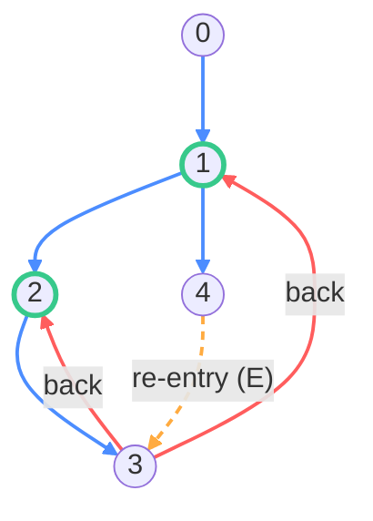

The [dominator tree](/blog/dominator-tree) lets us identify [natural loops](/blog/natural-loops): a back edge `T->H` whose head `H` dominates its tail `T` defines a loop with the single entry `H`.
This works only for _reducible_ control flow graphs.
Optimized machine code and decompiler output routinely contain _irreducible_ loops, which have more than one entry and thus no dominating header, so the dominator-based method cannot see them.

This post builds a loop-nesting forest for an arbitrary CFG with the single-pass depth-first search of 韦韬、毛剑、邹维、陈宇(Tao Wei, Jian Mao, Wei Zou & Yu Chen) _A New Algorithm for Identifying Loops in Decompilation_, SAS 2007 (The 14th International Static Analysis Symposium).

<!-- more -->

## Reducibility

A depth-first search from the entry classifies every non-tree edge relative to the spanning tree.
A _retreating edge_ `u->v` goes to an ancestor `v` of `u` on the DFS path.
A _cycle_ is a closed path in the CFG, a graph-theoretic object with no distinguished entry; a _loop_ is the control-flow structure built on top — a set of nodes with a header, nested into a forest.
A CFG is _reducible_ when, in every DFS, each retreating edge is a _back edge_ — its head `v` dominates its tail `u`.
Then every cycle lies in a natural loop whose header dominates it, so control enters the loop only through that header.

A CFG is _irreducible_ when some cycle has two or more entries: nodes with a predecessor outside the cycle.
No single node dominates the cycle, so there is no natural header.
The smallest example is the *irreducible core*:


Node 0 branches to both 1 and 2, and `1 -> 2 -> 1` is a cycle entered at 1 (through `0->1`) and at 2 (through `0->2`).
M.S. Hecht and J.D. Ullman proved that a CFG is irreducible if and only if it contains this three-node pattern as a subgraph, allowing each edge to be a path through other nodes.

Because no node dominates an irreducible cycle, the header is not intrinsic — we must pick one of the entries.
The standard choice (Havlak and the algorithm below) is the node the DFS reaches first, i.e. the loop member with the smallest preorder number.
So the loop-nesting forest of an irreducible CFG depends on the DFS order.

## Loop-nesting forest

There is no agreed definition of the loop-nesting forest for irreducible CFGs.
Steensgaard, Sreedhar–Gao–Lee, Havlak, and Ramalingam each give a different one; for the CFG in Wei et al.'s Fig. 3 they report two, one, three, and one loops respectively.
We adopt Havlak's, the finest, because it gives each loop a single header and the fewest `goto`s when re-structuring, and it is what LLVM's `GenericCycleInfo` computes:

* The outermost loops are the maximal strongly connected regions (with at least one internal edge).
* A loop's header is its minimum-preorder node.
* Its inner loops are the loops of the subgraph induced on (loop nodes − header), found recursively.

So nesting is set containment, not a reachability order: a subloop's nodes are a subset of its parent's (minus the parent's header), and since every loop is strongly connected, a loop and its subloops are mutually reachable.

The forest has a compact encoding.
For each node record its _innermost loop header_ `iloop_header`: the header of the smallest loop containing it, or none.
A header's own `iloop_header` is the header of its parent loop.
Following the `iloop_header` links from a node lists its enclosing loops innermost-first — the "loop header list" of the paper.
Which nodes are headers, plus every node's innermost header, determines the whole forest; that is what the program below prints.

## Representing and querying the forest

Building the forest is half the job; every consumer then asks two questions repeatedly: is a node inside loop `L`, and is loop `L2` nested in `L1`? How the forest is stored decides whether these are O(1).

The obvious layout gives each loop the set of all its nodes — its own plus every descendant's.
A membership test is one hash probe, but a node nested `d` loops deep is stored `d` times, so memory and build cost are `O(N * depth)`.

An Euler tour of the forest removes the duplication. Lay every node into one shared array so each loop owns a contiguous slice `[begin, end)` nested inside its parent's.
Each node then appears once, memory is `O(N)`, and both queries become interval tests:

- is a node inside `L`: map the node to its innermost loop, then test that loop's index against `L`'s slice;
- is `L2` nested in `L1`: `L1.begin <= L2.begin && L2.end <= L1.end`.

No per-loop set survives — the same trick `DominatorTree` uses for O(1) dominance (`DFSNumIn`/`DFSNumOut`), and the direction `GenericCycleInfo` took.

The header needn't be stored separately either: it is the first block of the loop's slice (the minimum-preorder member), so `begin` already locates it.

The contiguous slices suit a build-once analysis like `GenericCycleInfo`, but are costly to keep valid under the in-place CFG edits `LoopInfo` allows — which is why the two siblings compute the same forest yet store it differently.

## Identifying loops in one DFS pass

Natural loops need a dominator tree first.
Wei et al. observe that a single DFS with a little bookkeeping suffices for an arbitrary CFG — no dominator tree, no UNION-FIND, no second bottom-up pass.

Let `p` be the current DFS path, the recursion stack from the entry to the node being visited (`DFSP` in the paper).
`pos[b]` is `b`'s 1-based position on that path, or 0 once `b` has been popped.
Every node carries `iloop_header`, its innermost loop header discovered so far.
When visiting `b0`, each successor `b` falls into one of five cases:

- (A) `b` is unvisited — a tree edge. Recurse; the call returns `b`'s innermost header, which we merge into `b0`'s chain.
- (B) `b` is on the current path (`pos[b] > 0`) — a back edge. `b` is a loop header; merge it into `b0`.
- (C) `b` is finished and in no loop — a forward or cross edge to a non-loop node; ignore it.
- (D) `b` is finished, inside a loop whose innermost header `h` is still on the path — `b0` belongs to that loop too; merge `h`.
- (E) `b` is finished, inside a loop whose innermost header is _not_ on the path — the edge `b0->b` enters the loop below its header: a *re-entry edge*, and the loop is *irreducible*. Walk up `b`'s header chain to the first header that is on the path and merge that.

Merging a header (`tagLoopHeader`) splices it into the node's innermost-to-outermost chain, ordered by DFS position; this replaces the UNION-FIND of the classical Havlak–Tarjan algorithm.
The total cost is `O(N + k*E)`, where `k` is an _unstructuredness coefficient_ that measures the case-(E) climbs and the chain splices.
On real code `k` is tiny (empirically below 1.5), so the algorithm is near-linear.
That near-linearity hides a worst case: each `tagLoopHeader` splice is `O(depth)`, so on deeply nested loops `k` grows toward `O(N)` and the algorithm turns quadratic, whereas the UNION-FIND of Havlak–Tarjan stays near-linear even there.
In benchmarks Wei runs 2–4x faster on realistic CFGs but blows up on adversarial deep nests.

Successor order matters within that bound. When one block has several back edges to nested headers, visiting them outer-header-first (ascending preorder) keeps each splice `O(1)`, whereas innermost-first re-walks the chain every time — `O(d)` versus `O(d^2)` for that block. Iterating successors in reverse postorder approximates the good order for free. But this only shifts the constant: a spine of `d` nested loops with a single latch each costs `O(d*E)` in every order, so the worst case stands.

Havlak–Tarjan is not immune either; it just fails on different inputs. On that reducible deep nest its UNION-FIND collapses each single-entry loop, so it stays near-linear where Wei blows up — but its backward flood re-scans an absorbed subloop's whole _entry_ set, so a deeply nested loop that is also multi-entry (a high-in-degree block re-entered inside every level) costs it `O(E*depth)` too, Ramalingam's classic critique of Havlak. Neither is universally near-linear: Wei is quadratic on any deep nest, Havlak–Tarjan only on irreducible ones.

The input format matches the natural-loops post: `n m` on the first line, then `m` edges `u v`, with node 0 the entry.
The program identifies the loops, then materializes the flat Euler-tour layout described above: it prints the shared `layout` array, then walks the forest.
Each loop shows its slice `[begin, end)` — the full extent it and its subloops span — then the blocks it owns directly, header first (these fill the front of the slice, and the subloops' slices follow), and, if irreducible, its non-header entries.

```cpp
// Identify loops in one DFS pass, then lay them out as a flat block layout.
//
// "A New Algorithm for Identifying Loops in Decompilation"
//   Tao Wei, Jian Mao, Wei Zou, Yu Chen -- SAS 2007.
//
// A single depth-first traversal tags every node with its innermost loop header
// on the fly: no dominator tree, no UNION-FIND, no second bottom-up pass. It
// handles nested and irreducible (multi-entry) loops under Havlak's loop-nesting
// -forest definition.
//
// The forest is then flattened with no nested containers: loops are numbered by
// header preorder rank, sub-loops hang off a childHead/nextSibling list, and each
// loop records only its own block count. A reverse-preorder pass drops every
// in-loop block into one flat `layout` array, landing the header first in each
// loop's contiguous slice, so it need not be stored separately.
//
// Input:  n m / u v   (m directed edges u->v; node 0 is the entry)
//
// Successors are visited in input order. Recursion depth equals the longest DFS
// path, so extremely deep graphs need `ulimit -s unlimited`.
#include <algorithm>
#include <cassert>
#include <cstdio>
#include <utility>
#include <vector>
using namespace std;

// Per-node state kept together (AoS): one cache line per node beats parallel
// arrays. All fields default to 0/false, so assign() is a cheap zero-fill. `pos`
// (live only during the DFS) and `loopIdx` (live only after) never overlap, so
// they share one word.
struct Node {
  int ilh = 0;            // iloop_header: innermost loop header; dfs() sets the
                          //   -1 = none sentinel on first visit
  union {
    int pos = 0;          // during the DFS: 1-based path depth; 0 once off it
    int loopIdx;          // after the DFS: innermost-loop rank, -1 = none
  };
  bool traversed = false; // has the DFS reached this node?
  bool header = false;    // is this node the header of some loop?
};

vector<Node> nd;          // per-node state, indexed by node id
vector<vector<int>> succ; // successor lists, in input order
vector<int> preorder;     // node ids in DFS preorder
int numHeaders = 0;       // number of loop headers found by dfs()
// (h, b): an edge re-enters the closed loop headed by h at b, below the header,
// so b is a non-header entry of that (irreducible) loop.
vector<pair<int, int>> reentries;

// Weave header h (and its own header chain) into b's innermost-loop-header chain,
// ordered innermost..outermost by DFS-path position. Building it on the fly is
// why Wei needs no UNION-FIND.
void tagLoopHeader(int b, int h) {
  assert(h != -1);
  // Invariant: nd[b].pos >= nd[h].pos
  while (b != h) {
    int ih = nd[b].ilh;
    if (ih == -1) { // b's chain ended: append the rest of h's chain
      nd[b].ilh = h;
      return;
    }
    if (nd[ih].pos >= nd[h].pos)
      b = ih;
    else {
      nd[b].ilh = h;
      b = h;
      h = ih;
    }
  }
}

// Traverse b0 at path depth p; return b0's innermost loop header.
int dfs(int b0, int p) {
  nd[b0].ilh = -1; // first visit: install the "no header" sentinel
  nd[b0].pos = p;
  nd[b0].traversed = true;
  preorder.push_back(b0);
  for (int b : succ[b0]) {
    if (!nd[b].traversed) { // (A) tree edge: recurse, absorb child's header
      int h = dfs(b, p + 1);
      if (h >= 0)
        tagLoopHeader(b0, h);
    } else if (nd[b].pos > 0) { // (B) back edge: b is a loop header
      if (!nd[b].header) {      // count each distinct header once
        nd[b].header = true;
        ++numHeaders;
      }
      tagLoopHeader(b0, b);
    } else {
      // (C/D/E) climb b's header chain: each off-path header heads a closed loop
      // that b0->b re-enters below it (so b is a non-header entry). Stop at the
      // first on-path header and attribute b0 to that loop.
      for (int h = nd[b].ilh; h >= 0; h = nd[h].ilh) {
        if (nd[h].pos > 0) {
          tagLoopHeader(b0, h);
          break;
        }
        reentries.push_back({h, b});
      }
    }
  }
  nd[b0].pos = 0; // b0 leaves the DFS path
  return nd[b0].ilh;
}

// One record per loop, keyed by header preorder rank.
struct Loop {
  int header, childHead = -1, nextSibling = -1, ownCount = 1;
  int begin = 0, end = 0; // slice in `layout`
};
vector<Loop> loops;
vector<int> layout;
vector<vector<int>> entries; // header -> non-header entries
int cursor = 0;

// Reserve each loop a contiguous slice; `begin` temporarily holds the own-region
// end, which the fill pass below walks back down to the slice start.
void tour(int c) {
  cursor += loops[c].ownCount;
  loops[c].begin = cursor;
  for (int ch = loops[c].childHead; ch >= 0; ch = loops[ch].nextSibling)
    tour(ch);
  loops[c].end = cursor;
}

// Print loop c and its subloops, nested by indentation.
void dump(int c, int indent) {
  Loop &L = loops[c];
  printf("%*sloop %d  slice [%d,%d)  own blocks:", 2 * indent, "", L.header,
         L.begin, L.end);
  for (int i = L.begin; i < L.begin + L.ownCount; i++)
    printf(" %d", layout[i]); // header is layout[begin], the rest follow
  if (!entries[L.header].empty()) { // non-header entries => irreducible loop
    printf("  (non-header entries:");
    for (int e : entries[L.header])
      printf(" %d", e);
    putchar(')');
  }
  puts("");
  for (int ch = L.childHead; ch >= 0; ch = loops[ch].nextSibling)
    dump(ch, indent + 1);
}

int main() {
  int n, m;
  if (scanf("%d %d", &n, &m) != 2)
    return 0;
  succ.assign(n, {});
  for (int i = 0; i < m; i++) {
    int u, v;
    if (scanf("%d %d", &u, &v) != 2)
      return 1;
    succ[u].push_back(v);
  }
  nd.assign(n, Node{});
  if (n > 0)
    dfs(0, 1);

  int topHead = -1; // head of the root loops' sibling list
  if (numHeaders) {
    // Number loops by header preorder rank and resolve each block's innermost
    // loop in the same sweep; ilh is an already-numbered ancestor.
    loops.reserve(numHeaders);
    for (int v : preorder) {
      if (nd[v].header) {
        nd[v].loopIdx = loops.size();
        loops.push_back({v});
      } else if (nd[v].ilh >= 0) {
        nd[v].loopIdx = nd[nd[v].ilh].loopIdx;
        ++loops[nd[v].loopIdx].ownCount;
      } else {
        nd[v].loopIdx = -1;
      }
    }
    // Link loops under their parents. Ranks run in header preorder, so walking
    // them in reverse and prepending gives child lists in forward preorder.
    for (int c = (int)loops.size() - 1; c >= 0; c--) {
      int v = loops[c].header;
      int &head =
          nd[v].ilh >= 0 ? loops[nd[nd[v].ilh].loopIdx].childHead : topHead;
      loops[c].nextSibling = head;
      head = c;
    }
    // Size the slices, then fill blocks back-to-front so the header lands first.
    for (int c = topHead; c >= 0; c = loops[c].nextSibling)
      tour(c);
    layout.assign(cursor, 0);
    for (int i = (int)preorder.size() - 1; i >= 0; i--)
      if (nd[preorder[i]].loopIdx >= 0)
        layout[--loops[nd[preorder[i]].loopIdx].begin] = preorder[i];
    // Non-header entries per header, dropping duplicate re-entry edges.
    sort(reentries.begin(), reentries.end());
    reentries.erase(unique(reentries.begin(), reentries.end()), reentries.end());
    entries.assign(n, {});
    for (auto [h, b] : reentries)
      entries[h].push_back(b);
  }

  printf("block layout:");
  for (int b : layout)
    printf(" %d", b);
  puts("");
  for (int c = topHead; c >= 0; c = loops[c].nextSibling)
    dump(c, 0);
  return 0;
}
```

Non-header entries occur only at case-E targets. Here is an example:



## Examples

The irreducible core:

```
% ./wei_blocks
3 4
0 1
0 2
1 2
2 1
block layout: 1 2
loop 1  slice [0,2)  own blocks: 1 2  (non-header entries: 2)
```

The header is 1 because the DFS reaches 1 first.
List `0 2` before `0 1` and the header becomes 2 instead: the loop is the same set of nodes, but its header — and therefore the forest — depends on the DFS order, unlike a natural loop.

```
% ./wei_blocks
3 4
0 2
0 1
1 2
2 1
block layout: 2 1
loop 2  slice [0,2)  own blocks: 2 1  (non-header entries: 1)
```

A nested example: a reducible outer loop `{1,2,3}` (back edge `3->1`) containing an irreducible inner loop `{2,3}`, entered at 2 (via `1->2`) and at 3 (via `1->3`):


```
% ./wei_blocks
5 7
0 1
1 2
1 3
2 3
3 2
3 1
3 4
block layout: 1 2 3
loop 1  slice [0,3)  own blocks: 1
  loop 2  slice [1,3)  own blocks: 2 3  (non-header entries: 3)
```

Only the inner loop is irreducible; the outer loop has the single entry 1.
The nesting gives `3`'s header list, innermost-first: its innermost loop `{2,3}` (slice `[1,3)`) sits inside `{1,2,3}` (slice `[0,3)`).

Pipe any of these graphs through `awk 'BEGIN{print "digraph G{"} NR>1{print $1"->"$2} END{print "}"}'` to render them with graphviz.

## Relation to natural loops

On a reducible CFG the first-visited node of a loop is exactly the node that dominates it, so this algorithm's header coincides with the natural-loop header and the two forests are identical.
Running the program on the [natural loops](/blog/natural-loops) example — a reducible graph with a self-loop and an unreachable node — produces the same loops as that post's dominator-based program, with none marked irreducible (no non-header entries).

The Havlak–Tarjan algorithm reaches the same forest by a different route: a top-down DFS to find back edges, then a bottom-up UNION-FIND pass propagating headers from loop tails.
Wei et al.'s contribution is folding both passes into a single DFS, and their re-entry bookkeeping (case (E)) is what marks the irreducible loops along the way.

## Recent improvements to LLVM's CycleInfo

LLVM's `GenericCycleInfo` computes this loop-nesting forest — it just calls a loop a _cycle_. Several recent changes rebuild it around the structure above.

**Flat block layout.** Each cycle used to own a set of its blocks, so a block nested `d` deep was stored `d` times (`O(N*depth)`). Now every in-loop block lives once in a shared array, each cycle a contiguous slice nested inside its parent's, making `contains` and nested-in interval tests. The header is the slice's first block rather than a stored field, and an irreducible cycle's extra entries are appended — the `layout`/`tour`/`dump` the program above builds.

TODO **Single-pass construction.** The old code used a multi-pass scheme: a DFS to number blocks, then a reverse-preorder flood that grew each cycle from its back edges. It is now the single Wei DFS above — one traversal tags every block's innermost header and records the re-entries that make a cycle irreducible.
